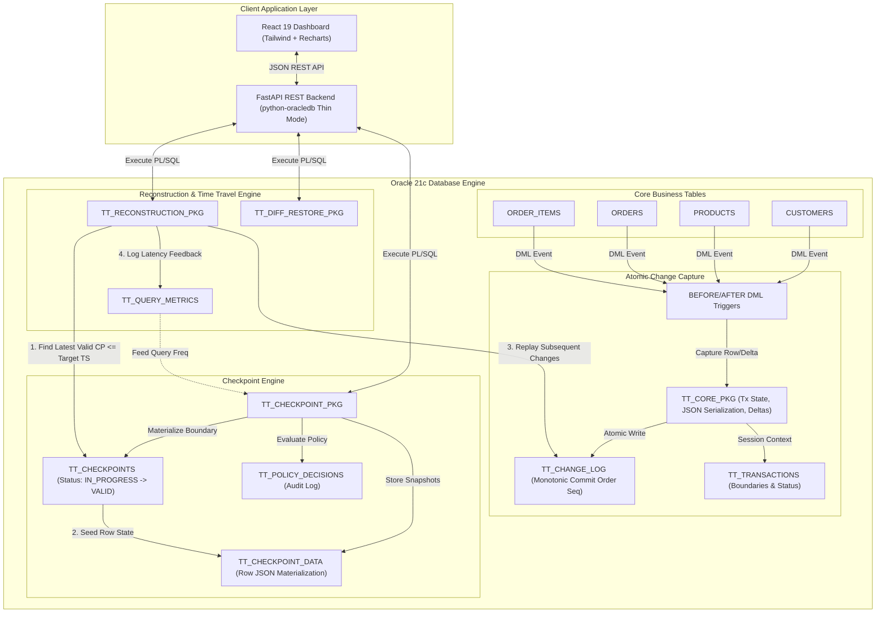
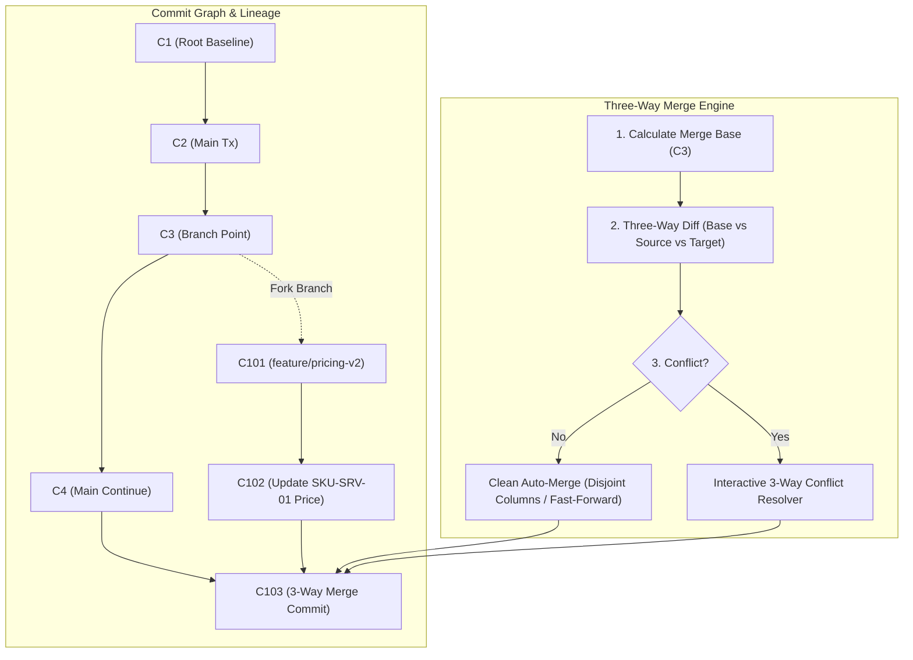

# Time Travel Database: A Workload-Aware Historical Data Reconstruction System Using Adaptive Checkpointing

[](https://github.com)
[](https://www.oracle.com/database/technologies/xe-downloads.html)
[](https://fastapi.tiangolo.com)
[](https://vitejs.dev)
[](https://tailwindcss.com)

A complete, production-grade DBMS system that preserves historical database changes and reconstructs the state of data at any requested point in time. Its primary contribution is an **optimized, workload-aware reconstruction engine using adaptive checkpointing** that balances historical storage overhead, query latency, and operational write performance without requiring full database snapshots after every transaction.

---

## 1. Problem Statement & Motivation

Traditional enterprise databases excel at maintaining and querying the **current** state of business entities. However, auditing, compliance, operational rollbacks, financial forensics, and trend analysis frequently require querying how records existed at specific points in the past (*Time Travel*).

Existing approaches suffer from major trade-offs:
1. **Full Database Snapshots:** Taking snapshot copies after every operation yields rapid historical reads but causes catastrophic storage explosion and severe I/O degradation.
2. **Pure Log-Only Replay:** Storing change logs without periodic checkpoints minimizes write overhead but forces historical queries to replay every operation from the beginning of time, causing $O(N)$ query latency that degrades over time.
3. **Fixed-Interval Checkpointing:** Creating checkpoints at static frequencies (e.g., every 50 transactions) ignores workload characteristics, creating checkpoints on idle tables or skipping them on high-throughput hotspots.

### Research Contribution
This system implements a **Workload-Aware Adaptive Checkpointing Policy** in Oracle SQL/PLSQL that evaluates:
- Cumulative changes since the previous checkpoint.
- Estimated historical replay cost in milliseconds.
- Observed historical query frequency over rolling time windows.
- Storage budget limits.

Checkpoints are materialized only when the replay cost to future historical reads outweighs the snapshot creation overhead.

---

## 2. Architecture & System Flow



---

## 3. Database Schema & Tables

### Core Business Tables
- `CUSTOMERS`: `customer_id` (PK), `name`, `email` (UNIQUE), `phone`, `status`, `credit_limit`, `created_at`, `updated_at`.
- `PRODUCTS`: `product_id` (PK), `sku` (UNIQUE), `name`, `category`, `unit_price`, `stock_quantity`, `created_at`, `updated_at`.
- `ORDERS`: `order_id` (PK), `customer_id` (FK), `order_date`, `status`, `total_amount`, `notes`, `updated_at`.
- `ORDER_ITEMS`: `item_id` (PK), `order_id` (FK, CASCADE), `product_id` (FK), `quantity`, `unit_price`, `subtotal`.

### Historical Tracking Objects
- `TT_TRANSACTIONS`: Tracks transactional boundary metadata, start/commit timestamps, and commit order sequences.
- `TT_CHANGE_LOG`: Row-level change audit log storing operation type (`INSERT`, `UPDATE`, `DELETE`, `RESTORE`), old values JSON, new values JSON, delta JSON, and commit order sequence.
- `TT_CHECKPOINTS`: Metadata for materialized snapshot boundaries (`checkpoint_id`, `table_name`, `target_boundary_ts`, `status`, `row_count`, `storage_bytes`).
- `TT_CHECKPOINT_DATA`: Exact row states materialized at each checkpoint boundary.
- `TT_POLICY_DECISIONS`: Auditable logs explaining why every checkpoint was created or skipped.
- `TT_QUERY_METRICS`: Historical query telemetries feeding runtime cost data back into the adaptive policy.
- `TT_CONFIG`: Dynamic system tuning parameters.

### Temporal Branching & Merge Objects
- `TT_BRANCHES`: Branch metadata (`branch_id`, `branch_name`, `parent_branch_id`, `base_commit_id`, `base_timestamp`, `branch_status`, `is_default`).
- `TT_BRANCH_COMMITS`: Immutable Git-like commit ledger (`commit_id`, `branch_id`, `parent_commit_id`, `commit_message`, `commit_timestamp`, `commit_order_seq`, `author`, `commit_type`, `merge_parent_commit_id`).
- `TT_BRANCH_CHANGESET`: Record-level modifications in each commit (`changeset_id`, `commit_id`, `table_name`, `record_id`, `operation_type`, `before_values`, `after_values`, `delta_values`).
- `TT_BRANCH_MERGE_HISTORY`: Audit trail for three-way and fast-forward merges (`merge_id`, `source_branch_id`, `target_branch_id`, `source_commit_id`, `target_commit_id`, `merge_commit_id`, `merge_status`, `conflicts_count`, `conflict_details`).

---

## 4. Key Algorithms

### A. Historical Reconstruction Algorithm
```text
FUNCTION ReconstructRow(table, record_pk, target_ts, strategy):
  1. IF strategy != 'LOG_ONLY':
       checkpoint = FindLatestCheckpoint(table, status='VALID', boundary_ts <= target_ts)
       IF checkpoint EXISTS:
         current_state = LoadRowFromCheckpointData(checkpoint.id, record_pk)
         boundary_seq = checkpoint.boundary_change_id
       ELSE:
         current_state = NULL; boundary_seq = 0
     ELSE:
       current_state = NULL; boundary_seq = 0

  2. changes = QueryChangeLog(
       table = table,
       record_pk = record_pk,
       commit_seq > boundary_seq,
       change_timestamp <= target_ts
     ) ORDER BY commit_seq ASC

  3. FOR EACH change IN changes:
       SWITCH change.operation_type:
         CASE 'INSERT': current_state = change.new_values
         CASE 'UPDATE': 
           IF change.new_values IS NOT NULL:
             current_state = change.new_values
           ELSE IF change.delta_values IS NOT NULL:
             ApplyDelta(current_state, change.delta_values)
         CASE 'DELETE': current_state = NULL

  4. LogQueryMetric(table, target_ts, strategy, count(changes), duration)
  5. RETURN Envelope(current_state, checkpoint_id, changes_replayed, duration)
```

### B. Workload-Aware Adaptive Checkpoint Policy
```text
FUNCTION EvaluateAdaptivePolicy(table):
  1. changes_since_last = CountChangesSinceLastValidCheckpoint(table)
  2. query_freq = CountHistoricalQueries(table, window=1 hour)
  3. estimated_replay_cost_ms = changes_since_last * 0.45 ms
  4. storage_used_mb = GetCheckpointStorageBytes() / (1024 * 1024)

  5. IF storage_used_mb >= STORAGE_BUDGET_MB:
       LogDecision('SKIPPED_STORAGE_LIMIT', 'Storage budget ceiling reached')
       RETURN 'SKIPPED_STORAGE_LIMIT'

  6. IF changes_since_last >= ADAPTIVE_CHANGE_THRESHOLD AND
        (estimated_replay_cost_ms >= REPLAY_COST_THRESHOLD OR query_freq >= QUERY_FREQ_THRESHOLD):
       new_cp_id = CreateCheckpoint(table, strategy='ADAPTIVE')
       LogDecision('CHECKPOINT_CREATED', 'High change rate and replay cost justifies checkpoint', new_cp_id)
       RETURN 'CHECKPOINT_CREATED'
     ELSE:
       LogDecision('SKIPPED_BELOW_THRESHOLD', 'Replay cost is more cost-effective than snapshot creation')
       RETURN 'SKIPPED_BELOW_THRESHOLD'
```

---

## 5. Temporal Branching & Merge Engine (GitHub-Inspired)

The database includes an advanced, Git-style temporal branching and merge system implemented natively in Oracle PL/SQL ([`TT_BRANCH_PKG`](file:///Users/patnambhanuprakash/Desktop/DBMS/database/16_create_branch_pkg.sql)). Users can fork independent database workspaces from the live head, from any historical timestamp, or from existing branch commits without mutating the production baseline.



### Three-Way Merge Resolution Logic
Given Common Ancestor $S_{\text{base}}$, Source Branch $S_{\text{source}}$, and Target Branch $S_{\text{target}}$:
* **Unchanged in both:** Preserve $S_{\text{target}}$.
* **Modified only in Source:** Safely apply Source change to Target.
* **Modified only in Target:** Retain Target version.
* **Modified in both:**
  * **Disjoint Columns:** Automatically merged (e.g., Source modified `status`, Target modified `credit_limit`).
  * **Same Column Differently:** Flagged as `SAME_COLUMN_MODIFICATION` conflict.
  * **Delete vs Update:** Flagged as `DELETE_VS_UPDATE` conflict.
  * **Concurrent Insert:** Flagged as `CONCURRENT_INSERT` conflict.
* **Interactive Conflict Resolution:** Allows granular acceptance of Source, Target, or Custom values before committing the merge transaction.

---

## 6. Comparison: Our Engine vs. Oracle Flashback Data Archive

| Feature | Our Adaptive Time Travel Engine | Oracle Flashback Data Archive (FDA) |
| :--- | :--- | :--- |
| **Technology** | Custom SQL, PL/SQL packages, Triggers | Proprietary internal Oracle kernel process (`fbda`) |
| **Checkpointing** | **Workload-Aware Adaptive Checkpointing** (cost/benefit evaluated) | Internal undo retention / periodic table partitions |
| **Portability & License** | Runs on free Oracle Database 21c XE | Advanced features require Enterprise Edition options |
| **Custom Diffing** | Native JSON-based column deltas with old/new tracking | Requires `VERSIONS BETWEEN` flash queries |
| **Restoration Safety** | Forward-only audited transaction with preview & constraint check | `FLASHBACK TABLE` can overwrite uncommitted live work |
| **Transparency** | Explicit decision logs in `TT_POLICY_DECISIONS` | Black-box kernel heuristics |

---

## 7. Quick Start

### Prerequisites
- Python 3.10+
- Node.js 18+ and npm
- (Optional) Docker for Oracle Database 21c XE container

### Option 1: Run Services Locally (with Instant Emulator)
The system includes a zero-dependency high-fidelity Oracle engine emulator, allowing the entire application, API endpoints, test suite, and React UI to run immediately out of the box:

```bash
# 1. Start both backend and frontend concurrently
./scripts/start_services.sh
```
- Frontend UI: [http://localhost:5173](http://localhost:5173)
- FastAPI Swagger Docs: [http://localhost:8000/docs](http://localhost:8000/docs)

### Option 2: Run with Oracle Database 21c XE in Docker
```bash
# 1. Start Oracle 21c XE container
docker compose up -d oracle-db

# 2. Apply database schemas, packages, triggers, branching tables, and seed data
source venv/bin/activate
python scripts/setup_database.py

# 3. Start services
./scripts/start_services.sh
```

---

## 8. Running Tests & Benchmarks

### Correctness Test Suite
Run the 34 automated pytest unit & integration tests covering INSERT, UPDATE, DELETE, rollback semantics, checkpoints, adaptive policy decisions, diffs, safe restorations, and the 15 temporal branching & merge scenarios:

```bash
source venv/bin/activate
PYTHONPATH=backend pytest backend/tests -v
```

### Automated Benchmark Comparison
To run the automated empirical benchmark comparing **Log-Only**, **Fixed-Interval**, and **Adaptive Checkpointing**:

```bash
# From UI: Navigate to "Benchmark Center" and click "Run Benchmark Comparison"
# Or via REST API:
curl -X POST http://localhost:8000/api/benchmarks/run \
  -H "Content-Type: application/json" \
  -d '{"workload_size": "MEDIUM", "read_write_ratio": 0.7}'
```
Benchmarks automatically record:
- History storage vs Checkpoint storage (Bytes)
- Average & p95 reconstruction latency (ms)
- Changes replayed per query
- Write throughput (TPS)
- Checkpoint creation duration (ms)
Results are persisted to `benchmarks/results/` as JSON and CSV exports.

---

## 9. REST API Reference

| Endpoint | Method | Description |
| :--- | :--- | :--- |
| `/api/health` | `GET` | Health check and database engine connection details |
| `/api/tables` | `GET` | Supported tables overview and row counts |
| `/api/tables/{table}/records` | `GET` | Filter and browse current records |
| `/api/time-travel/row` | `POST` | Reconstruct row at historical timestamp with strategy selection |
| `/api/time-travel/table` | `POST` | Reconstruct entire table at historical timestamp |
| `/api/timeline/{table}/{pk}` | `GET` | Full chronological mutation timeline for a specific record |
| `/api/diff` | `POST` | Structural and row-level diff between two timestamps |
| `/api/checkpoints` | `GET`, `POST` | List checkpoints or trigger manual boundary checkpoint |
| `/api/checkpoints/evaluate-adaptive`| `POST` | Trigger adaptive policy evaluation on a table |
| `/api/checkpoints/decisions` | `GET` | Auditable decision log explaining trigger vs skip decisions |
| `/api/restore/preview` | `POST` | Preview proposed restoration and validate constraints |
| `/api/restore/execute` | `POST` | Commit safe restoration as a new forward transaction |
| `/api/branches` | `GET`, `POST` | List all branches or create new branch from HEAD/timestamp/commit |
| `/api/branches/{branch_id}` | `GET`, `DELETE` | Inspect branch metadata or safely delete branch |
| `/api/branches/{branch_id}/commits` | `GET`, `POST` | Commit isolated DML changes or inspect branch commit history |
| `/api/branches/{branch_id}/state` | `GET` | Reconstruct effective active records on the branch |
| `/api/branches/{branch_id}/timeline` | `GET` | Get visual SVG commit graph nodes and merge links |
| `/api/branches/compare` | `POST` | Compare two branches with fine-grained column deltas |
| `/api/branches/merge` | `POST` | Execute three-way or fast-forward merge with conflict detection |
| `/api/branches/merge/{merge_id}/resolve`| `POST` | Resolve detected merge conflicts with accepted values |
| `/api/branches/merge/{merge_id}/abort` | `POST` | Abort a conflicted or pending merge operation |
| `/api/benchmarks/run` | `POST` | Execute reproducible benchmark comparing all 3 strategies |
| `/api/benchmarks/history` | `GET` | Historical benchmark run comparisons |
| `/api/storage/stats` | `GET` | Detailed storage breakdown and budget utilization |
| `/api/settings` | `GET`, `POST` | View and tune adaptive policy thresholds |

---

## 10. Documentation & Syllabus Mapping

Comprehensive technical guides and course topic mappings are maintained in the [`docs/`](file:///Users/patnambhanuprakash/Desktop/DBMS/docs) directory:

| Document | Purpose |
| :--- | :--- |
| **[`CHAPTERWISE_TOPICS_MAPPING.md`](file:///Users/patnambhanuprakash/Desktop/DBMS/docs/CHAPTERWISE_TOPICS_MAPPING.md)** | **Complete chapter-by-chapter mapping of course slides (Ch 1–7, 13–14, 17–19) to project source files** |
| **[`ARCHITECTURE.md`](file:///Users/patnambhanuprakash/Desktop/DBMS/docs/ARCHITECTURE.md)** | Three-tier architecture, same-transaction CDC, branching engine, and reconstruction flow |
| **[`DATABASE_DESIGN.md`](file:///Users/patnambhanuprakash/Desktop/DBMS/docs/DATABASE_DESIGN.md)** | E-R diagrams, table schemas, check constraints, branching schema, and B-Tree indexing strategy |
| **[`BENCHMARK_METHODOLOGY.md`](file:///Users/patnambhanuprakash/Desktop/DBMS/docs/BENCHMARK_METHODOLOGY.md)** | Synthetic workload generation comparing Log-Only, Fixed-Interval, and Adaptive policies |
| **[`SQL_DEMONSTRATION.md`](file:///Users/patnambhanuprakash/Desktop/DBMS/docs/SQL_DEMONSTRATION.md)** | Step-by-step SQL*Plus / SQL Developer guide using Oracle JSON_TABLE projections |
| **[`TESTING.md`](file:///Users/patnambhanuprakash/Desktop/DBMS/docs/TESTING.md)** | Automated test execution, unit suites, and diagnostic emulator verification |
| **[`DEPLOYMENT_GUIDE.md`](file:///Users/patnambhanuprakash/Desktop/DBMS/docs/DEPLOYMENT_GUIDE.md)** | Docker Compose and native production installation instructions |

---

## 11. License & Academic Attribution
Developed as an advanced DBMS research implementation. Designed for high-integrity historical auditing, temporal branching workspaces, and workload-aware database reconstruction.
