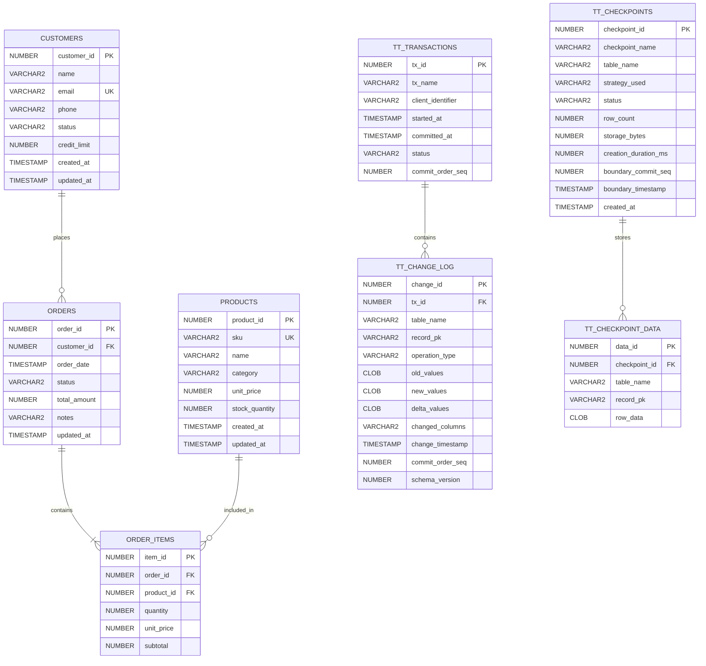

# Database Design: Time Travel Database System
**Target Engine:** Oracle Database 21c XE / Standard Edition  
**Dialect:** Oracle SQL & PL/SQL  

---

## 1. Entity-Relationship Model (Mermaid Diagram)

---

## 2. Table Specifications & Constraint Details

### 2.1. Business Tables
1. **`CUSTOMERS`**:
   - `customer_id` (NUMBER, PK): Primary key populated from `CUSTOMER_ID_SEQ`.
   - `name` (VARCHAR2(100), NOT NULL): Customer legal or corporate name.
   - `email` (VARCHAR2(100), UNIQUE, NOT NULL): Unique contact email.
   - `status` (VARCHAR2(20), CHECK `status IN ('ACTIVE','INACTIVE','SUSPENDED','VIP')`).
   - `credit_limit` (NUMBER(12,2), CHECK `credit_limit >= 0`).

2. **`PRODUCTS`**:
   - `product_id` (NUMBER, PK): Primary key from `PRODUCT_ID_SEQ`.
   - `sku` (VARCHAR2(50), UNIQUE, NOT NULL): Stock keeping unit.
   - `unit_price` (NUMBER(10,2), CHECK `unit_price >= 0`).
   - `stock_quantity` (NUMBER(8), CHECK `stock_quantity >= 0`).

3. **`ORDERS`**:
   - `order_id` (NUMBER, PK): Primary key from `ORDER_ID_SEQ`.
   - `customer_id` (NUMBER, FK): References `CUSTOMERS(customer_id)`.
   - `status` (VARCHAR2(20), CHECK `status IN ('PENDING','PROCESSING','COMPLETED','DELIVERED','CANCELLED')`).
   - `total_amount` (NUMBER(12,2), CHECK `total_amount >= 0`).

4. **`ORDER_ITEMS`**:
   - `item_id` (NUMBER, PK): Primary key from `ORDER_ITEM_ID_SEQ`.
   - `order_id` (NUMBER, FK): References `ORDERS(order_id)` ON DELETE CASCADE.
   - `product_id` (NUMBER, FK): References `PRODUCTS(product_id)`.
   - `quantity` (NUMBER(6), CHECK `quantity > 0`).

---

### 2.2. Temporal & History Tables
1. **`TT_CHANGE_LOG`**:
   - `change_id` (NUMBER, PK): Monotonic sequence `TT_CHANGE_SEQ`.
   - `tx_id` (NUMBER, FK): Links to `TT_TRANSACTIONS(tx_id)`.
   - `table_name` (VARCHAR2(60), NOT NULL): Target entity.
   - `record_pk` (VARCHAR2(255), NOT NULL): Primary key value as string.
   - `operation_type` (VARCHAR2(10), CHECK `IN ('INSERT','UPDATE','DELETE','RESTORE')`).
   - `old_values` (CLOB, CHECK `IS JSON`): Full state prior to operation.
   - `new_values` (CLOB, CHECK `IS JSON`): Full state after operation.
   - `delta_values` (CLOB, CHECK `IS JSON`): Minimal JSON patch of altered columns only.
   - `commit_order_seq` (NUMBER, NOT NULL): Strict deterministic sequencing.

2. **`TT_CHECKPOINTS` & `TT_CHECKPOINT_DATA`**:
   - Stores pre-materialized row states at verified points in time.
   - Indexed by `(table_name, boundary_timestamp)` for rapid $O(\log n)$ lookup during historical queries.

3. **`TT_POLICY_DECISIONS`**:
   - `decision_id` (NUMBER, PK).
   - `table_name` (VARCHAR2(60)).
   - `input_metrics` (VARCHAR2(500)): Explains delta count, query frequency, and storage weight.
   - `computed_score` (NUMBER(10,3)): The numerical score from the adaptive cost model.
   - `action_taken` (VARCHAR2(30)): `CHECKPOINT_CREATED` or `DEFERRED_BELOW_COST_THRESHOLD`.
   - `decision_reason` (VARCHAR2(500)): Human-readable explanation.

---

## 3. Indexing Strategy for Reconstruction Performance

| Index Name | Table | Indexed Columns | Purpose |
| :--- | :--- | :--- | :--- |
| `IDX_TT_CHANGELOG_LOOKUP` | `TT_CHANGE_LOG` | `(table_name, record_pk, change_timestamp)` | Fast point lookup for single-row reconstruction |
| `IDX_TT_CHANGELOG_TIME` | `TT_CHANGE_LOG` | `(table_name, change_timestamp, commit_order_seq)` | Table-wide time range scans |
| `IDX_TT_CHANGELOG_SEQ` | `TT_CHANGE_LOG` | `(commit_order_seq)` | Strict commit ordering during delta replay |
| `IDX_TT_CP_LOOKUP` | `TT_CHECKPOINTS` | `(table_name, boundary_timestamp, status)` | Fast discovery of nearest preceding checkpoint |
| `IDX_TT_CP_DATA` | `TT_CHECKPOINT_DATA` | `(checkpoint_id, table_name, record_pk)` | Instant retrieval of baseline row at checkpoint |
| `IDX_TT_QMETRICS_TBL_TIME` | `TT_QUERY_METRICS`| `(table_name, queried_at)` | Dynamic query frequency window computation |
